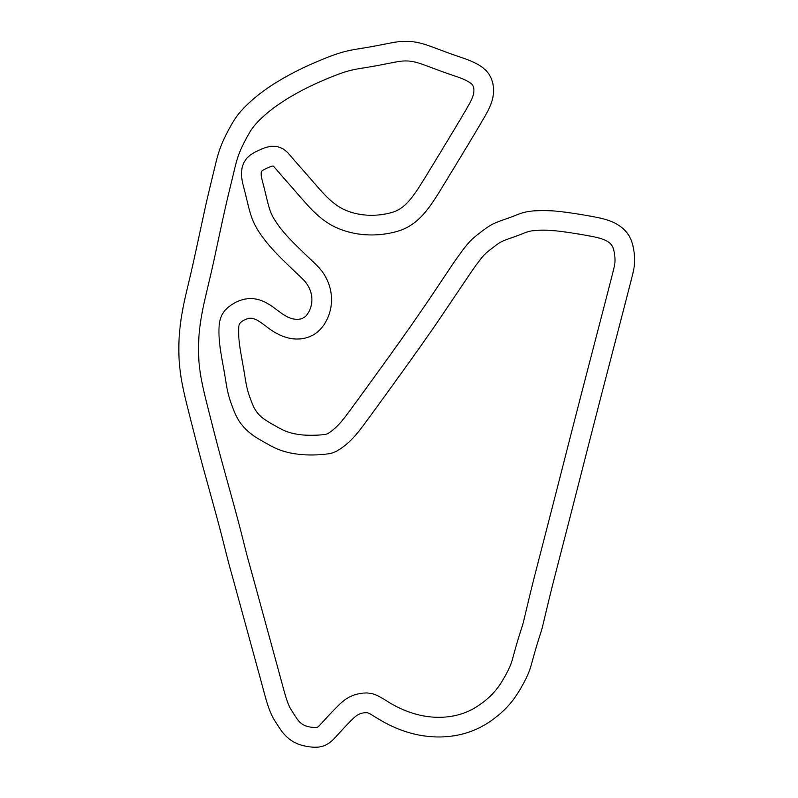
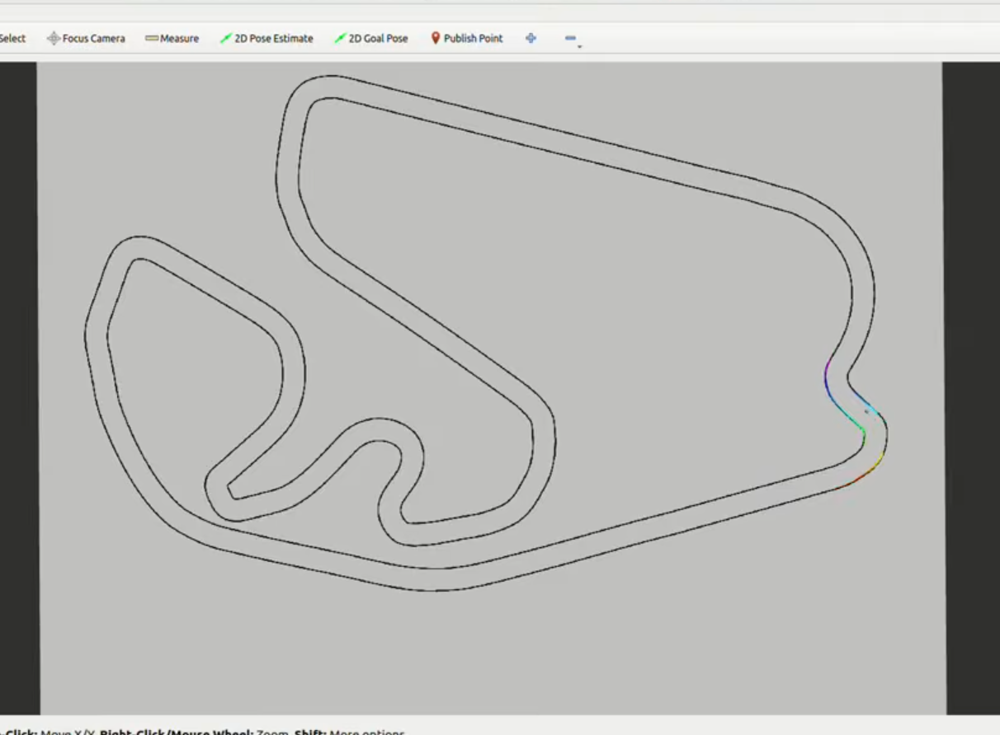
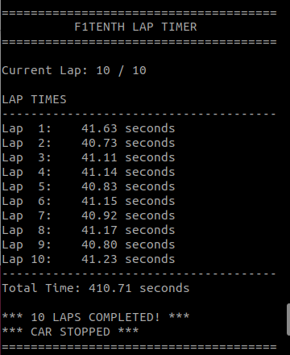

# F1TENTH Autonomous Driving Using Follow-the-Gap

An autonomous driving project developed using **ROS 2 Humble** and the **F1TENTH Gym Simulator**. The vehicle uses LiDAR sensor data and a Reactive Follow-the-Gap algorithm to navigate a race track, avoid obstacles, and complete 10 laps automatically.

## 1. Project Overview

The objective is to develop an autonomous vehicle controller capable of navigating a race track using LiDAR data.

Main features:
- Reactive obstacle avoidance using Follow-the-Gap.
- LiDAR preprocessing and noise reduction.
- Automatic steering control.
- Adaptive vehicle speed.
- Emergency stopping.
- Automatic lap counting and timing.
- Automatic stopping after 10 completed laps.

### Simulation Environment

- Simulator: F1TENTH Gym
- ROS Version: ROS 2 Humble
- Programming Language: Python
- Map: São Paulo Race Track



*Figure 1. São Paulo race track used for autonomous driving experiments.*

---
# 2. Complete Gap Follow Controller Source Code

This section provides the complete Python implementation of the Follow-the-Gap controller. Users can copy the source code below, save it as `gap_node.py`, and use it in their ROS 2 workspace.

## 2.1 Complete Python Code – gap_node.py

```python
import math
import time
import json

import numpy as np
import rclpy
from rclpy.node import Node

from sensor_msgs.msg import LaserScan
from ackermann_msgs.msg import AckermannDriveStamped
from nav_msgs.msg import Odometry
from std_msgs.msg import String


class ReactiveFollowGap(Node):

    def __init__(self):
        super().__init__('follow_gap_controller')

        # Lap counter: virtual start/finish gate
        self.target_laps = 10
        self.lap_count = 0

        # Lap timing
        self.start_time = None
        self.last_lap_time = None
        self.lap_times = []

        self.total_distance = 0.0
        self.last_lap_distance = 0.0
        self.min_lap_distance = 50.0

        self.prev_x = None
        self.prev_y = None
        self.prev_s = None

        self.start_x = None
        self.start_y = None
        self.start_yaw = None

        self.gate_armed = False
        self.arm_distance = 5.0
        self.gate_lateral_tolerance = 2.0
        self.gate_heading_tolerance = 0.6

        self.odom_received = False
        self.finished = False

        # Start/finish gate at initial vehicle position
        self.gate_y_tolerance = 2.0
        self.gate_heading_tolerance = 0.5

        # Vehicle settings
        self.max_speed = 15.28
        self.min_speed = 2.0
        self.max_steering = 0.4189

        # Follow-the-Gap settings
        self.safety_radius = 0.40
        self.emergency_distance = 0.25
        self.front_angle = 0.65

        self.last_steering = 0.0

        # LiDAR subscriber
        self.lidar_sub = self.create_subscription(
            LaserScan,
            '/scan',
            self.lidar_callback,
            10
        )

        # Odometry subscriber
        self.odom_sub = self.create_subscription(
            Odometry,
            '/ego_racecar/odom',
            self.odom_callback,
            10
        )

        # Vehicle drive publisher
        self.drive_pub = self.create_publisher(
            AckermannDriveStamped,
            '/drive',
            10
        )

        # Publish lap information for the separate timer terminal
        self.lap_info_pub = self.create_publisher(
            String,
            '/lap_info',
            10
        )

        self.get_logger().info(
            'Follow-the-Gap initialized. Target: 10 laps.'
        )

    def publish_drive(self, speed, steering):
        msg = AckermannDriveStamped()
        msg.header.stamp = self.get_clock().now().to_msg()
        msg.header.frame_id = 'base_link'
        msg.drive.speed = float(speed)
        msg.drive.steering_angle = float(steering)

        self.drive_pub.publish(msg)

    def odom_callback(self, msg):

        if self.finished:
            return

        x = msg.pose.pose.position.x
        y = msg.pose.pose.position.y

        q = msg.pose.pose.orientation

        yaw = math.atan2(
            2.0 * (q.w * q.z + q.x * q.y),
            1.0 - 2.0 * (q.y * q.y + q.z * q.z)
        )

        # Record the initial vehicle pose
        if self.start_x is None:
            self.start_x = x
            self.start_y = y
            self.start_yaw = yaw

            now = time.monotonic()
            self.start_time = now
            self.last_lap_time = now

            self.prev_x = x
            self.prev_y = y
            self.prev_s = 0.0

            self.odom_received = True

            self.get_logger().info(
                f'Virtual start gate set at ({x:.2f}, {y:.2f}), '
                f'yaw={yaw:.2f}'
            )
            return

        # Calculate traveled distance
        distance = math.hypot(
            x - self.prev_x,
            y - self.prev_y
        )

        self.total_distance += distance

        # Calculate distance from virtual start position
        dx = x - self.start_x
        dy = y - self.start_y

        distance_from_start = math.hypot(dx, dy)

        # Calculate heading difference
        yaw_difference = math.atan2(
            math.sin(yaw - self.start_yaw),
            math.cos(yaw - self.start_yaw)
        )

        # Arm gate after leaving the start area
        if distance_from_start > self.arm_distance:
            self.gate_armed = True

        # Detect return to the virtual start area
        crossed_gate = (
            self.gate_armed
            and distance_from_start <= self.gate_lateral_tolerance
            and abs(yaw_difference) <= self.gate_heading_tolerance
            and (
                self.total_distance - self.last_lap_distance
                >= self.min_lap_distance
            )
        )

        if crossed_gate:
            self.gate_armed = False
            self.lap_count += 1
            self.last_lap_distance = self.total_distance

            # Calculate lap and total time
            now = time.monotonic()
            lap_elapsed = now - self.last_lap_time
            total_elapsed = now - self.start_time

            self.last_lap_time = now
            self.lap_times.append(lap_elapsed)

            # Publish lap information
            lap_msg = String()
            lap_msg.data = json.dumps({
                'lap': self.lap_count,
                'target_laps': self.target_laps,
                'lap_time': lap_elapsed,
                'total_time': total_elapsed,
                'lap_times': self.lap_times,
                'finished': self.lap_count >= self.target_laps
            })

            self.lap_info_pub.publish(lap_msg)

            self.get_logger().info(
                f'Lap {self.lap_count}/{self.target_laps} | '
                f'Lap time: {lap_elapsed:.2f} s | '
                f'Total time: {total_elapsed:.2f} s'
            )

            if self.lap_count >= self.target_laps:
                self.finished = True
                self.publish_drive(0.0, 0.0)

                self.get_logger().info(
                    f'10 LAPS COMPLETED! CAR STOPPED! '
                    f'TOTAL TIME: {total_elapsed:.2f} seconds'
                )

        self.prev_x = x
        self.prev_y = y

    def lidar_callback(self, data):

        if self.finished:
            self.publish_drive(0.0, 0.0)
            return

        if not self.odom_received:
            self.publish_drive(0.0, 0.0)
            return

        ranges = np.asarray(data.ranges, dtype=np.float32)

        if len(ranges) == 0 or data.angle_increment == 0.0:
            self.publish_drive(0.0, 0.0)
            return

        # Replace invalid LiDAR readings
        ranges[~np.isfinite(ranges)] = data.range_max
        ranges[ranges <= 0.0] = data.range_max

        ranges = np.clip(
            ranges,
            data.range_min,
            data.range_max
        )

        # Smooth LiDAR readings
        window = 5
        padded = np.pad(ranges, (2, 2), mode='edge')

        ranges = np.convolve(
            padded,
            np.ones(window) / window,
            mode='valid'
        )

        # Consider only the forward field of view
        angles = (
            data.angle_min
            + np.arange(len(ranges)) * data.angle_increment
        )

        roi = np.where(
            np.abs(angles) <= self.front_angle
        )[0]

        if len(roi) == 0:
            self.publish_drive(0.0, 0.0)
            return

        front_ranges = ranges[roi].copy()
        front_angles = angles[roi]

        # Emergency stop
        closest_index = int(np.argmin(front_ranges))
        closest_distance = float(front_ranges[closest_index])

        if closest_distance < self.emergency_distance:
            self.publish_drive(0.0, 0.0)

            self.get_logger().warn(
                f'EMERGENCY STOP: {closest_distance:.2f} m'
            )
            return

        # Create safety bubble around the closest obstacle
        angle_increment = abs(data.angle_increment)

        bubble_angle = math.asin(
            min(
                1.0,
                self.safety_radius / max(closest_distance, 0.05)
            )
        )

        bubble_size = int(
            bubble_angle / angle_increment
        ) + 2

        start = max(0, closest_index - bubble_size)

        end = min(
            len(front_ranges),
            closest_index + bubble_size + 1
        )

        front_ranges[start:end] = 0.0

        # Find continuous free-space gaps
        free_mask = front_ranges > 0.05

        padded_mask = np.concatenate(
            ([False], free_mask, [False])
        )

        changes = np.diff(padded_mask.astype(int))

        starts = np.where(changes == 1)[0]
        ends = np.where(changes == -1)[0] - 1

        if len(starts) == 0:
            self.publish_drive(0.0, 0.0)
            return

        # Select the largest gap
        lengths = ends - starts + 1
        best_gap = int(np.argmax(lengths))

        gap_start = starts[best_gap]
        gap_end = ends[best_gap]

        # Select the center of the largest gap
        if gap_end < gap_start:
            self.publish_drive(0.0, 0.0)
            return

        best_index = (gap_start + gap_end) // 2

        steering = float(front_angles[best_index])

        steering = float(np.clip(
            steering,
            -self.max_steering,
            self.max_steering
        ))

        # Smooth steering
        steering = (
            0.5 * self.last_steering
            + 0.5 * steering
        )

        self.last_steering = steering

        # Adaptive speed
        steering_factor = (
            abs(steering) / self.max_steering
        )

        speed = self.max_speed - (
            self.max_speed - self.min_speed
        ) * (min(steering_factor, 1.0) ** 0.6)

        # Slow down when an obstacle is close in front
        center = len(front_ranges) // 2

        front_window = front_ranges[
            max(0, center - 20):
            min(len(front_ranges), center + 21)
        ]

        front_distance = float(np.min(front_window))

        if front_distance < 1.5:
            speed = min(speed, 0.6)

        if front_distance < 0.8:
            speed = min(speed, 0.4)

        self.publish_drive(speed, steering)

        self.get_logger().info(
            f'Lap: {self.lap_count}/{self.target_laps} | '
            f'Speed: {speed:.2f} m/s | '
            f'Steering: {steering:.3f} rad | '
            f'Front: {front_distance:.2f} m'
        )


def main(args=None):

    rclpy.init(args=args)

    controller = ReactiveFollowGap()

    try:
        rclpy.spin(controller)

    except KeyboardInterrupt:
        pass

    finally:
        controller.publish_drive(0.0, 0.0)
        controller.destroy_node()
        rclpy.shutdown()


if __name__ == '__main__':
    main()
```

## 2.2 Controller Parameters

The main parameters can be modified directly inside the `__init__()` function of the `ReactiveFollowGap` class.

| Parameter | Default value | Description |
|---|---:|---|
| `target_laps` | 10 | Number of laps before stopping |
| `max_speed` | 15.28 m/s | Maximum vehicle speed |
| `min_speed` | 2.0 m/s | Minimum adaptive speed |
| `max_steering` | 0.4189 rad | Maximum steering angle |
| `safety_radius` | 0.40 m | Safety bubble radius |
| `emergency_distance` | 0.25 m | Emergency stopping distance |
| `front_angle` | 0.65 rad | Forward LiDAR field of view |
| `arm_distance` | 5.0 m | Distance required to arm the lap counter |
| `gate_lateral_tolerance` | 2.0 m | Start/finish detection tolerance |
| `min_lap_distance` | 50.0 m | Minimum distance before counting another lap |

To change the controller behavior, modify the corresponding values, save the file, and rebuild the package.

## 2.3 Software Requirements

- Ubuntu Linux
- ROS 2 Humble
- Python 3
- NumPy
- F1TENTH Gym ROS 2 simulator
- `ackermann_msgs`
- `sensor_msgs`
- `nav_msgs`
- `std_msgs`

Install the required packages:

```bash
sudo apt update
sudo apt install ros-humble-ackermann-msgs ros-humble-sensor-msgs ros-humble-nav-msgs ros-humble-std-msgs python3-numpy
```

## 2.4 LiDAR Data Processing

The controller receives LaserScan messages from `/scan`.

Invalid measurements are replaced with the maximum sensor range. A moving average filter with a window size of 5 is then applied to reduce noise.

```python
ranges[~np.isfinite(ranges)] = data.range_max
ranges[ranges <= 0.0] = data.range_max

ranges = np.clip(
    ranges,
    data.range_min,
    data.range_max
)

window = 5
padded = np.pad(ranges, (2, 2), mode='edge')

ranges = np.convolve(
    padded,
    np.ones(window) / window,
    mode='valid'
)
```

## 2.5 Forward Field of View

Only LiDAR measurements within the forward field of view are considered.

```python
angles = (
    data.angle_min
    + np.arange(len(ranges)) * data.angle_increment
)

roi = np.where(
    np.abs(angles) <= self.front_angle
)[0]
```

The configured forward angle is ±0.65 radians.

## 2.6 Emergency Stop

The controller identifies the closest obstacle. If its distance is below 0.25 meters, the vehicle immediately receives a zero-speed command.

```python
closest_index = int(np.argmin(front_ranges))
closest_distance = float(front_ranges[closest_index])

if closest_distance < self.emergency_distance:
    self.publish_drive(0.0, 0.0)
    return
```

## 2.7 Safety Bubble

A safety bubble is created around the closest obstacle. The corresponding LiDAR measurements are removed from the available free space.

```python
bubble_angle = math.asin(
    min(
        1.0,
        self.safety_radius / max(closest_distance, 0.05)
    )
)

bubble_size = int(
    bubble_angle / angle_increment
) + 2

start = max(0, closest_index - bubble_size)

end = min(
    len(front_ranges),
    closest_index + bubble_size + 1
)

front_ranges[start:end] = 0.0
```

## 2.8 Finding the Largest Gap

The controller identifies continuous regions of free space and selects the largest gap.

```python
free_mask = front_ranges > 0.05

padded_mask = np.concatenate(
    ([False], free_mask, [False])
)

changes = np.diff(padded_mask.astype(int))

starts = np.where(changes == 1)[0]
ends = np.where(changes == -1)[0] - 1

if len(starts) == 0:
    self.publish_drive(0.0, 0.0)
    return

lengths = ends - starts + 1
best_gap = int(np.argmax(lengths))

gap_start = starts[best_gap]
gap_end = ends[best_gap]

best_index = (gap_start + gap_end) // 2

steering = float(front_angles[best_index])
```

The center of the largest gap becomes the desired steering direction.

## 2.9 Steering Control

The steering angle is limited to the configured maximum and smoothed to reduce sudden changes.

```python
steering = float(np.clip(
    steering,
    -self.max_steering,
    self.max_steering
))

steering = (
    0.5 * self.last_steering
    + 0.5 * steering
)

self.last_steering = steering
```

---

## 3. Adaptive Speed Control

The vehicle adjusts its speed according to the steering angle. Larger steering angles result in lower speeds.

```python
steering_factor = (
    abs(steering) / self.max_steering
)

speed = self.max_speed - (
    self.max_speed - self.min_speed
) * (min(steering_factor, 1.0) ** 0.6)
```

Additional speed reduction is applied when an obstacle is close to the front of the vehicle.

```python
center = len(front_ranges) // 2

front_window = front_ranges[
    max(0, center - 20):
    min(len(front_ranges), center + 21)
]

front_distance = float(np.min(front_window))

if front_distance < 1.5:
    speed = min(speed, 0.6)

if front_distance < 0.8:
    speed = min(speed, 0.4)
```

### Vehicle Parameters

| Parameter | Value | Description |
|---|---:|---|
| Maximum speed | 15.28 m/s | 55 km/h maximum |
| Minimum speed | 2.0 m/s | Minimum adaptive speed |
| Maximum steering | 0.4189 rad | Steering angle limit |
| Safety radius | 0.40 m | Obstacle safety bubble |
| Emergency distance | 0.25 m | Emergency stop threshold |
| Forward field of view | ±0.65 rad | LiDAR forward region |
| LiDAR smoothing window | 5 | Moving average filter |
| Target laps | 10 | Required number of laps |

**Note:** 15.28 m/s is the configured maximum speed. Actual speed changes dynamically according to steering angle and obstacle distance.

---

## 4. Automatic Lap Counting and Timing

The controller uses odometry data from `/ego_racecar/odom`.

The first received vehicle position is recorded as the virtual start/finish position.

A lap is detected when:
1. The vehicle moves more than 5 meters away from the starting position.
2. The vehicle returns within 2 meters of the starting position.
3. The vehicle heading is within the configured heading tolerance.
4. The vehicle has traveled at least 50 meters since the previous lap.

The controller calculates individual lap times and total elapsed time using `time.monotonic()`.

```python
now = time.monotonic()

lap_elapsed = now - self.last_lap_time
total_elapsed = now - self.start_time

self.last_lap_time = now
self.lap_times.append(lap_elapsed)
```

Lap information is published through `/lap_info` using a `std_msgs/msg/String` message containing JSON data.

After completing 10 laps, the controller publishes a zero-speed command and stops the vehicle.

---

## 5. Lap Timer Display Implementation

A separate ROS 2 node named `lap_timer_display.py` displays lap information in another terminal.

It subscribes to `/lap_info`, receives JSON messages from the main controller, and displays:
- Current lap number.
- Individual lap times.
- Total elapsed time.
- Completion status.

### Complete Code: `lap_timer_display.py`

```python
import json

import rclpy
from rclpy.node import Node
from std_msgs.msg import String


class LapTimerDisplay(Node):

    def __init__(self):
        super().__init__('lap_timer_display')

        self.subscription = self.create_subscription(
            String,
            '/lap_info',
            self.lap_callback,
            10
        )

        self.get_logger().info('Waiting for lap information...')

    def lap_callback(self, msg):
        try:
            data = json.loads(msg.data)

            lap = data['lap']
            target = data['target_laps']
            lap_times = data['lap_times']
            total_time = data['total_time']
            finished = data['finished']

            print('\033[2J\033[H', end='')

            print('=' * 38)
            print('          F1TENTH LAP TIMER')
            print('=' * 38)

            print(f'\nCurrent Lap: {lap} / {target}\n')

            print('LAP TIMES')
            print('-' * 38)

            for i, lap_time in enumerate(lap_times, 1):
                print(f'Lap {i:2}: {lap_time:8.2f} seconds')

            print('-' * 38)
            print(f'Total Time: {total_time:.2f} seconds')

            if finished:
                print('\n*** 10 LAPS COMPLETED! ***')
                print('*** CAR STOPPED ***')

            print('=' * 38, flush=True)

        except (KeyError, ValueError, TypeError) as error:
            self.get_logger().error(f'Invalid lap data: {error}')


def main(args=None):
    rclpy.init(args=args)

    node = LapTimerDisplay()

    try:
        rclpy.spin(node)
    except KeyboardInterrupt:
        pass
    finally:
        node.destroy_node()
        rclpy.shutdown()


if __name__ == '__main__':
    main()
```

### Registering the Executable

The `lap_timer_display` executable must be registered in `setup.py`.

```python
'lap_timer_display = controllers.lap_timer_display:main',
```

The main controller executable is also registered:

```python
'gap_node = controllers.gap_node:main',
```

---

## 6. ROS 2 Communication

The controller communicates with the simulator through ROS 2 topics.

| Topic | Message Type | Function |
|---|---|---|
| `/scan` | `sensor_msgs/msg/LaserScan` | LiDAR sensor measurements |
| `/ego_racecar/odom` | `nav_msgs/msg/Odometry` | Vehicle position and orientation |
| `/drive` | `ackermann_msgs/msg/AckermannDriveStamped` | Vehicle speed and steering commands |
| `/lap_info` | `std_msgs/msg/String` | Lap count and timing information |

### Communication Flow

```text
       F1TENTH Simulator
               |
               v
          LiDAR Sensor
               |
               v
             /scan
               |
               v
    Follow-the-Gap Controller
               |
       +-------+-------+
       |               |
       v               v
  Obstacle         Adaptive
  Avoidance        Speed Control
       |               |
       +-------+-------+
               |
               v
             /drive
               |
               v
        Vehicle Movement

       Vehicle Odometry
               |
               v
      /ego_racecar/odom
               |
               v
       Lap Counter & Timer
               |
               v
           /lap_info
               |
               v
      Lap Timer Display
```

---

## 7. Code Structure

```text
F1Tenth-Repository/
│
├── src/
│   ├── controllers/
│   │   ├── controllers/
│   │   │   ├── gap_node.py
│   │   │   └── lap_timer_display.py
│   │   │
│   │   └── setup.py
│   │
│   └── f1tenth_gym_ros/
│       ├── maps/
│       │   ├── SaoPaulo_map.png
│       │   └── SaoPaulo_map.yaml
│       └── config/
│
├── docs/
│   └── images/
│       ├── track_map.png
│       ├── vehicle_running.png
│       └── lap_timer.png
│
└── README.md
```

### Main Files

| File | Description |
|---|---|
| `gap_node.py` | Main Follow-the-Gap controller, obstacle avoidance, speed control, lap counter and timing publisher |
| `lap_timer_display.py` | Separate terminal display for lap timing information |
| `setup.py` | Registers ROS 2 executable entry points |
| `SaoPaulo_map.png` | Race track map |

---

## 8. Installation and Execution

### Requirements

- Ubuntu Linux
- ROS 2 Humble
- F1TENTH Gym Simulator
- Python 3
- Required ROS 2 packages and dependencies

### Step 1: Build the Workspace

```bash
source /opt/ros/humble/setup.bash

cd ~/F1Tenth-Repository

colcon build --packages-select controllers
```

### Step 2: Launch the Simulator

Open Terminal 1:

```bash
source /opt/ros/humble/setup.bash

export ROS_DOMAIN_ID=20

cd ~/F1Tenth-Repository

source install/setup.bash

ros2 launch f1tenth_gym_ros gym_bridge_launch.py
```

### Step 3: Run the Follow-the-Gap Controller

Open Terminal 2:

```bash
source /opt/ros/humble/setup.bash

export ROS_DOMAIN_ID=20

cd ~/F1Tenth-Repository

source install/setup.bash

ros2 run controllers gap_node
```

### Step 4: Run the Lap Timer Display

Open Terminal 3:

```bash
source /opt/ros/humble/setup.bash

export ROS_DOMAIN_ID=20

cd ~/F1Tenth-Repository

source install/setup.bash

ros2 run controllers lap_timer_display
```

The vehicle will start autonomous navigation. The lap timer display will show timing information as laps are completed.

After completing 10 laps, the controller automatically publishes a zero-speed command.

---

## 9. Experimental Results

The controller was tested on the São Paulo race track using the F1TENTH Gym Simulator.



*Figure 2. Autonomous vehicle navigating the São Paulo race track.*

### Lap Timing Results



*Figure 3. Lap counter and timing display after the autonomous driving test.*

| Performance Metric | Result |
|---|---:|
| Target laps | 10 |
| Completed laps | 10 |
| Total time | 410.71 s |
| Average lap time | 41.07 s |
| Fastest lap | 40.73 s |
| Slowest lap | 41.63 s |

The vehicle successfully completed all 10 laps. The controller recorded individual lap times and total elapsed time, then automatically stopped the vehicle after the final lap.

---

## 13. Project Demonstration Video

This video demonstrates the F1TENTH autonomous vehicle project,
including LiDAR-based obstacle avoidance, adaptive speed control,
and autonomous lap completion.

https://youtu.be/CXdJdL85M5k?si=6kJ22GjpZGtvWXIs

---

## 10. Conclusion

This project demonstrates an autonomous driving system using ROS 2 and the Follow-the-Gap algorithm.

The controller processes LiDAR measurements to identify free space, avoid obstacles, and select a safe steering direction. Adaptive speed control improves navigation around corners and nearby obstacles.

A separate lap timer display and odometry-based lap counter were also implemented to measure performance over 10 laps.

The simulation results demonstrate that the vehicle can navigate the selected race track autonomously, complete the required laps, and stop automatically at the end of the experiment.

---

## 11. Future Improvements

Possible future improvements include:

- More advanced speed planning for sharp corners.
- Improved obstacle detection and gap selection.
- More accurate lap detection.
- Testing on additional race tracks.
- Comparing performance under different maximum speed settings.
